<div align="center">

# 🎟️ showitup

### Discover events, pick your seats live, and get a QR ticket in seconds.

A full-stack MERN event and ticketing platform with real-time seat locking, role-based dashboards for attendees, organizers and admins, and a demo mode that runs end to end with nothing but a database.

[](https://github.com/omsolanki1535/showitup/actions/workflows/ci.yml)


[Quick start](#-quick-start) · [Features](#-features) · [Screenshots](#-screenshots) · [Architecture](#-architecture) · [Deploy](#-deployment) · [What I changed](#-what-i-changed) · [Credits](#-credits)

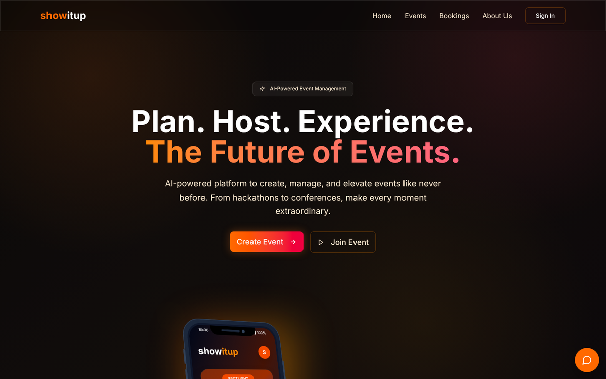

</div>

---

## ⚡ Quick start

### With Docker (one command)

```bash
git clone https://github.com/omsolanki1535/showitup.git
cd showitup
docker compose up --build -d
docker compose exec backend npm run seed
```

Open **http://localhost:8080** and sign in with a demo account:

| Role | Email | Password |
|---|---|---|
| 🎫 Attendee | `attendee@showitup.demo` | `Demo@1234` |
| 🎤 Organizer | `organizer@showitup.demo` | `Demo@1234` |
| 🛡️ Admin | `admin@showitup.demo` | `Demo@1234` |

### Without Docker

Prerequisites: Node.js 20+ and MongoDB, either local or a free [Atlas](https://www.mongodb.com/atlas) cluster.

```bash
# API: http://localhost:8000
cd backend
cp .env.example .env        # set MONGO_URI and JWT_SECRET
npm install
npm run seed                # demo accounts and sample events
npm run dev

# Web app: http://localhost:5173 (in a second terminal)
cd frontend
cp .env.example .env        # VITE_API=http://localhost:8000/api
npm install
npm run dev
```

> **💡 Demo mode:** Razorpay, Gmail and Gemini keys are all optional. Without them, payments are simulated (the order is still priced and checked on the server), OTPs print in the backend terminal, and the chatbot says it isn't configured. `GET /api/health` shows which mode each integration is in.

---

## ✨ Features

<table>
<tr>
<td width="33%" valign="top">

### 🎫 Attendees
- Browse, search and filter events with no login needed
- Live seat map: seats other people are selecting show up instantly through Socket.IO
- Seats are held for 5 minutes while you check out
- Razorpay checkout, or the built-in demo payment
- QR-code ticket, downloadable PDF and email confirmation
- Booking history and event reviews

</td>
<td width="33%" valign="top">

### 🎤 Organizers
- 5-step event wizard: details, schedule, seating grid, options and tier
- Dashboard with bookings, revenue and active shows
- Edit or delete events (deleting is blocked once tickets are sold)
- Attendee booking list
- Review insights with sentiment analysis
- Email marketing campaigns to attendees

</td>
<td width="33%" valign="top">

### 🛡️ Admins
- Platform overview: users, organizers, events and revenue
- Today's activity: signups, new events, tickets and revenue
- User management: search, filter, change roles, remove users and export to CSV
- Event monitoring across all organizers
- Event category analytics

</td>
</tr>
</table>

**Also included:** OTP email verification at signup · AI event assistant (Google Gemini with function calling) · automatic event status updates (upcoming → active → completed) · responsive dark UI with glassmorphism.

---

## 📸 Screenshots

| Browse events | Live seat selection |
|---|---|
| 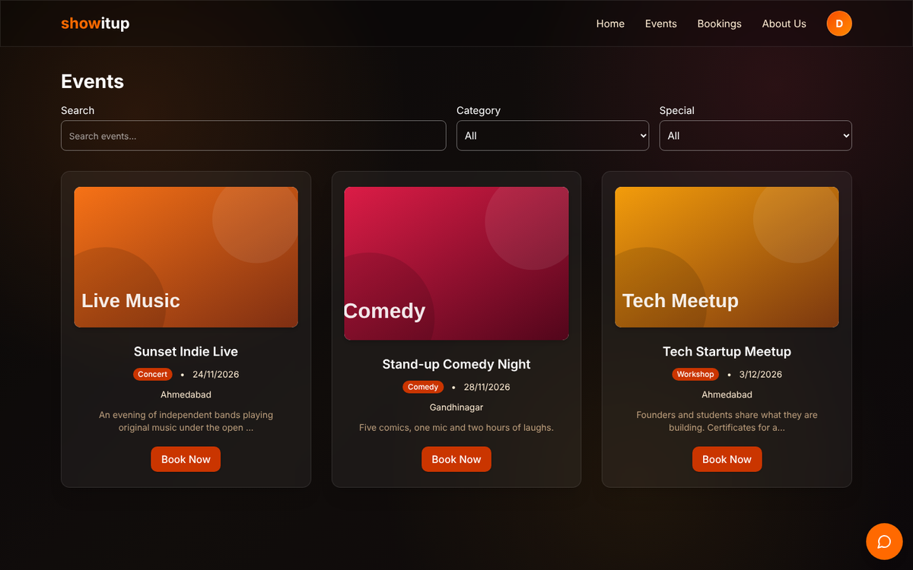 | 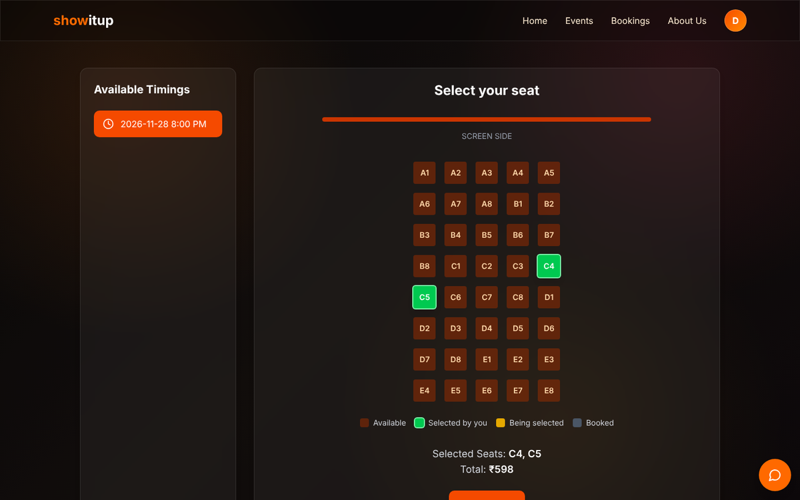 |
| **Checkout with QR ticket** | **My bookings** |
| 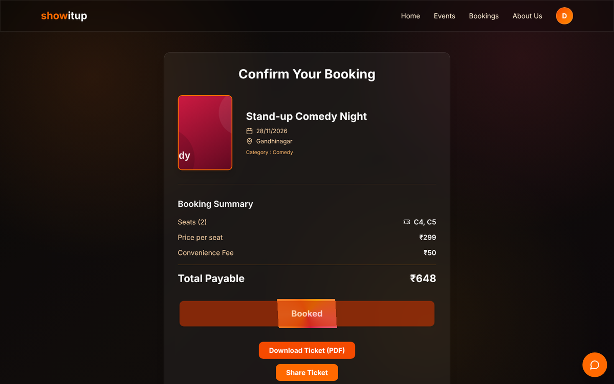 | 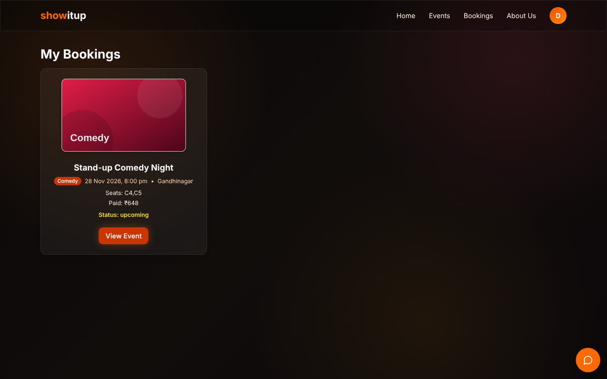 |
| **Organizer dashboard** | **Create an event** |
| 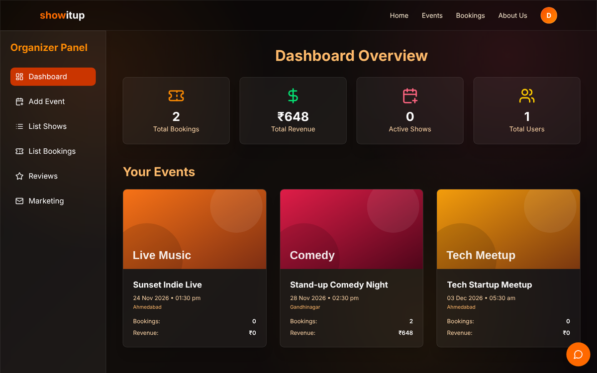 | 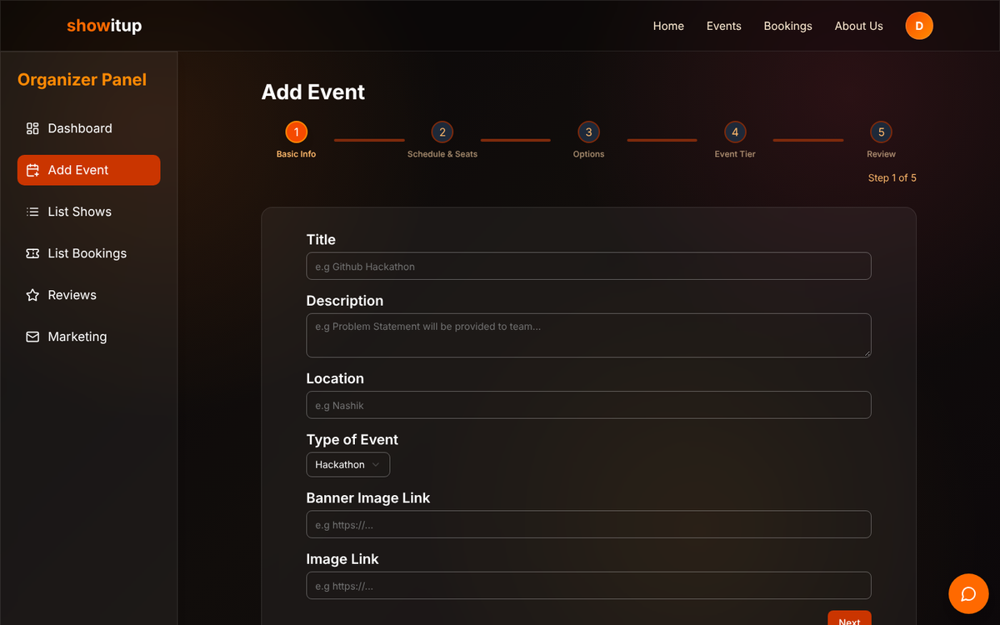 |
| **Admin dashboard** | **Admin user management** |
| 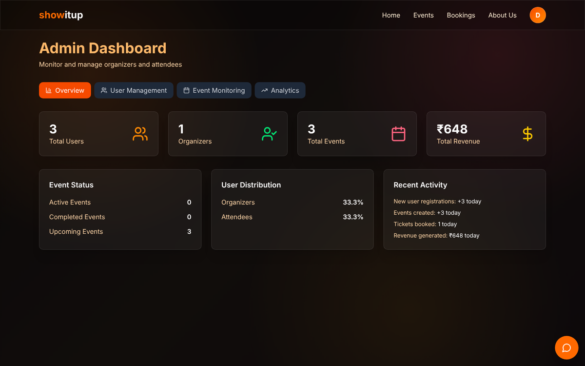 | 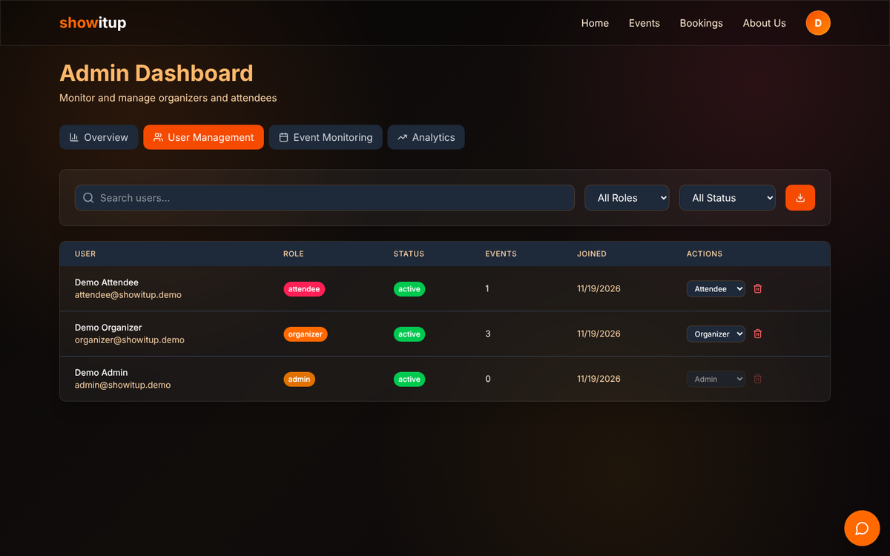 |
| **Event details** | **Organizer bookings** |
| 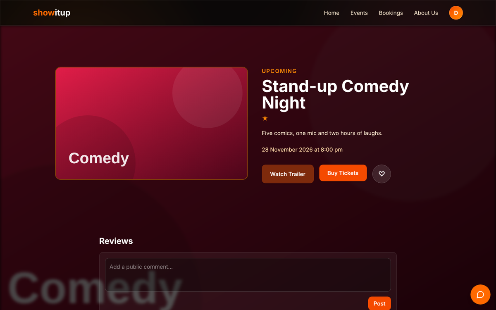 | 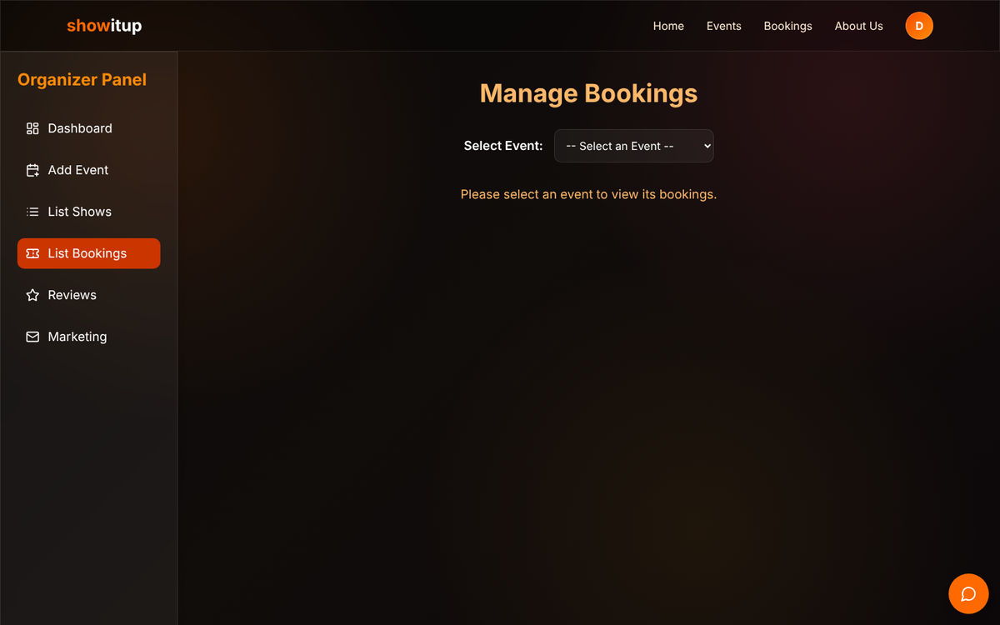 |

<p align="center">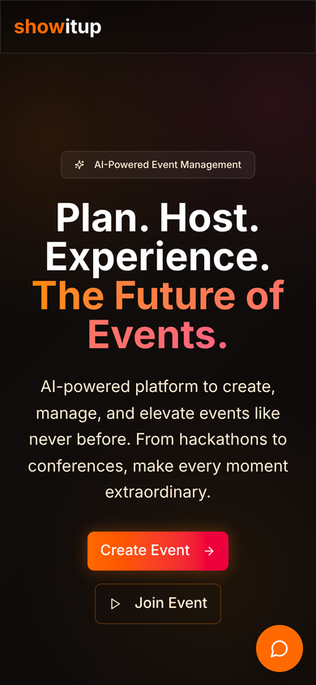<br/><sub>Responsive on mobile</sub></p>

---

## 🏗️ Architecture

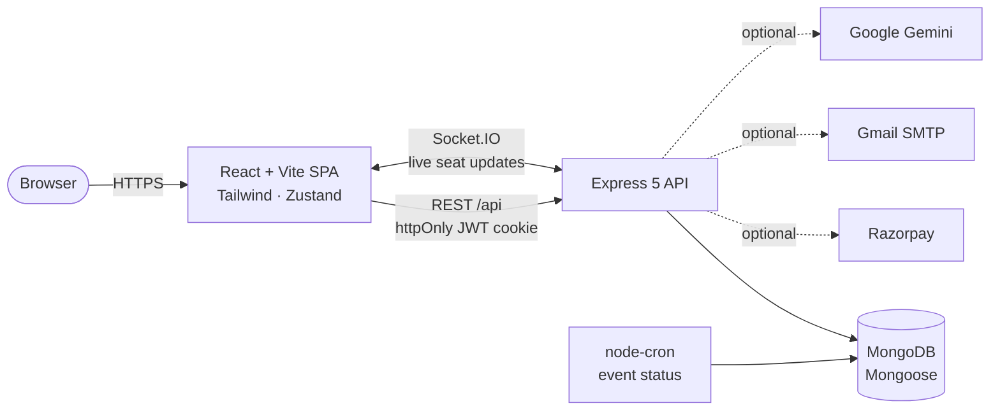

### How a booking stays correct

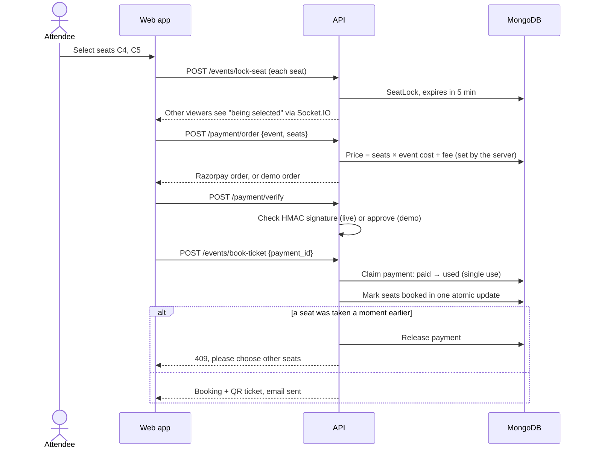

---

## 🧰 Tech stack

| Layer | Technology |
|---|---|
| Frontend | React 19, Vite 7, Tailwind CSS 4, shadcn/ui and Radix, Zustand, React Router 7, Socket.IO client, jsPDF |
| Backend | Node.js 22, Express 5, Mongoose 8, Socket.IO 4, JWT, bcrypt, node-cron, Nodemailer, QRCode, Sentiment |
| Integrations | Razorpay, Google Gemini (function calling), Gmail SMTP. All optional, with demo fallbacks |
| Security | Helmet, express-rate-limit, httpOnly cookies, role-based middleware, env validation |
| Quality | Jest + Supertest end-to-end API tests, ESLint, GitHub Actions CI, Artillery load tests |
| Delivery | Docker and Docker Compose, nginx, Render Blueprint, Vercel config |

---

## 📁 Project structure

```
showitup/
├── backend/
│   ├── config/env.js            # env loading, validation, feature modes
│   ├── controllers/             # users, events, payments, reviews, marketing, admin, chatbot
│   ├── middlewares/             # auth roles, rate limits
│   ├── models/                  # User, Event, Booking, Payment, SeatLock, Review
│   ├── routes/
│   ├── services/                # Razorpay and Gemini clients
│   ├── scripts/                 # seed-demo.js, create-admin.js
│   ├── tests/                   # Jest + Supertest
│   ├── app.js                   # Express app (security, routes, health, errors)
│   └── server.js                # HTTP + Socket.IO server, cron, graceful shutdown
├── frontend/
│   ├── src/pages/               # attendee/, organizer/, admin/, auth and landing
│   ├── src/components/          # Navbar, Footer, shadcn/ui
│   ├── nginx.conf               # SPA + API reverse proxy for Docker
│   └── vercel.json
├── testing/                     # Artillery load tests
├── docs/                        # deployment guide, change log, screenshots
├── docker-compose.yml
├── render.yaml
└── .github/workflows/ci.yml
```

---

## 🔌 API overview

All routes are under `/api`. 🔒 = needs login · 🎤 = organizer · 🎫 = attendee · 🛡️ = admin

| Area | Endpoints |
|---|---|
| Health | `GET /start` · `GET /health` |
| Auth | `POST /user/register` · `POST /user/otp-verify` · `POST /user/resend-otp` · `POST /user/login` · `POST /user/logout` · 🔒 `GET /user/getUserProfile` |
| Events (public) | `GET /events/get-events` · `GET /events/get-events/:id` · `GET /events/get-seats-times/:id` · `POST /events/ask` (chatbot) |
| Seats | 🔒 `POST /events/lock-seat` · `POST /events/unlock-seat` · `GET /events/seat-locks/:eventId` · `POST /events/check-seats-with-locks` |
| Booking | 🎫 `POST /payment/order` · `POST /payment/verify` · `POST /events/book-ticket` · 🔒 `GET /events/get-my-bookings` |
| Organizer | 🎤 `POST /events/add-events` · `GET /events/get-my-events` · `POST /events/update-my-event/:id` · `DELETE /events/delete-my-event/:id` · `GET /events/get-bookings` · `GET /events/getOrganizerSummary` · `GET /marketing/get-emails` · `POST /marketing/bulk-email` |
| Reviews | 🔒 `POST /review/addreview` · `GET /review/getreviews/:event_id` · `GET /review/top` |
| Admin | 🛡️ `GET /admin/dashboard` · `PATCH /admin/users/:id/role` · `DELETE /admin/users/:id` |

---

## 🧪 Testing

```bash
cd backend
# End-to-end API tests need a disposable database (it gets wiped)
MONGO_URI_TEST=mongodb://127.0.0.1:27017/showitup_test npm test
```

The suite covers signup and OTP, blocking Admin self-signup, hiding password hashes, role checks, server-side pricing, single-use payments, and **two people paying for the same seat at the same moment** (exactly one booking succeeds and the other payment is released).

```bash
cd frontend && npm run lint && npm run build     # frontend checks
npx artillery run testing/load-test.yml          # load test (see testing/)
```

CI runs all of this on every push and pull request.

---

## 🚀 Deployment

| Target | How |
|---|---|
| **Any server with Docker** | `docker compose up --build -d` |
| **Render + MongoDB Atlas** (free) | **New > Blueprint** in Render picks up `render.yaml` |
| **Vercel + Node host** | Frontend root `frontend/`, API on any Node 20+ host |

The full step-by-step guide, with environment variables and a production checklist, is in **[docs/DEPLOYMENT.md](docs/DEPLOYMENT.md)**.

<details>
<summary><b>Environment variables</b></summary>

| Variable | Required | Purpose |
|---|---|---|
| `MONGO_URI` | ✅ | MongoDB connection string |
| `JWT_SECRET` | ✅ | Signs login tokens; at least 32 characters in production |
| `CLIENT_URL` | ✅ in production | Allowed frontend origin(s), comma separated |
| `SERVER_URL` | | Public API URL, used by the keep-alive ping |
| `EMAIL`, `PASSWORD` | | Gmail address and app password for OTP and ticket emails |
| `RAZORPAY_KEY`, `RAZORPAY_KEY_SECRET` | | Live payments (blank = demo payments) |
| `GEMINI_API_KEY` | | AI chatbot |
| `CONVENIENCE_FEE` | | Booking fee in ₹ (default 50) |
| `APP_TIMEZONE` | | Time zone for event times (default `Asia/Kolkata`) |
| `KEEP_ALIVE` | | `true` pings the API so free hosts don't sleep |
| `VITE_API` (frontend) | ✅ | API base URL ending in `/api` |
| `VITE_RAZORPAY_KEY` (frontend) | | Razorpay key id (public) |

</details>

<details>
<summary><b>Create a real admin account</b></summary>

Admin can't be chosen at signup. Create one from the server:

```bash
cd backend
npm run create-admin -- admin@yourdomain.com "Admin Name" "a-strong-password"
```

</details>

---

## 🛠️ What I changed

This project started from an existing open-source MERN ticketing app (see [Credits](#-credits)). This is the work I did on top of it to make it secure, testable and ready to deploy. The full list is in **[docs/CHANGES.md](docs/CHANGES.md)**.

**Bugs fixed**
- The backend crashed on startup without Razorpay keys. It now has a full demo payment mode.
- Payment verification hung forever when a signature was wrong.
- The organizer dashboard threw on an undefined variable, and the API returned 404 errors for empty lists.
- Event times showed in the server's time zone (UTC) instead of Indian time.
- The admin dashboard showed hard-coded "today" numbers. It now shows real data.
- The admin user-management buttons did nothing. Role change, delete, CSV export and event links now work.

**Security fixes**
- Anyone could register as **Admin** by sending `role: "Admin"`.
- The checkout amount came from the browser. Orders are now priced on the server.
- One payment could be reused for unlimited bookings. Payments are now single use.
- Two buyers could get the same seat. Seats are now booked in one atomic database update.
- Organizers could overwrite revenue and seat maps. Edits now use an allow-list of fields.
- Any user could download every attendee's email and send bulk mail. This is now organizer-only, and only for their own events.
- Password hashes and OTPs were returned by the API.
- Chatbot input went straight into a database regex. It is now escaped.
- A real person's login was committed in the load-test files. It has been removed.

**Production readiness**
- Helmet, rate limiting, env validation, a health endpoint, a central error handler and graceful shutdown
- Docker images, Docker Compose, a Render Blueprint, Vercel config and GitHub Actions CI
- End-to-end API tests, a demo data seeder, and lint cleanup (15 errors down to 0)

---

## 🙏 Credits

- **Original project:** [HostMyShow](https://github.com/sakshinehe/hostmyshow) by **sakshinehe**. It provided the original MERN codebase, UI and core feature set. I received it through my mentor's repository and built this version on top of it.
- **This version:** rebranding (showitup, ember theme), local OTP demo mode, and the fixes, security work, tests and deployment setup listed in [What I changed](#-what-i-changed).
- Photos in the demo data are from [Unsplash](https://unsplash.com).

If you reuse this code, keep the credit to the original project and check its license.

<div align="center">
<sub>Built with ☕ and a lot of seat maps.</sub>
</div>
